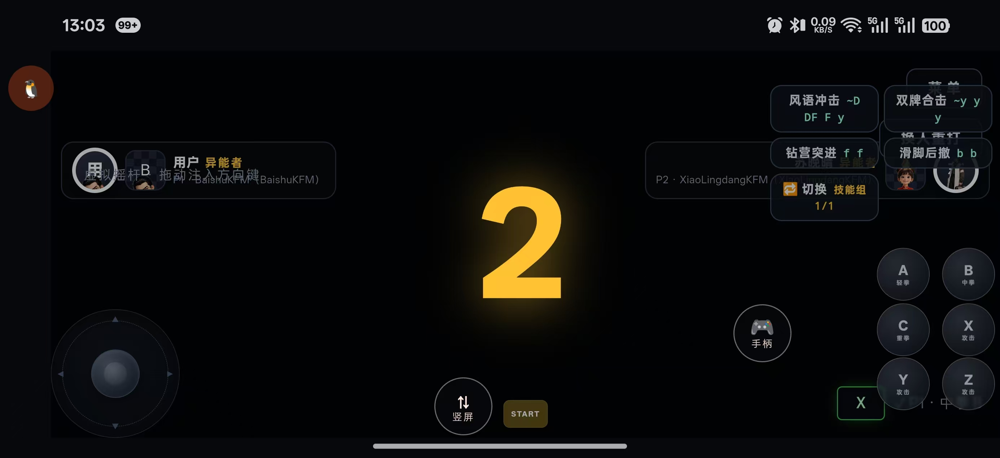
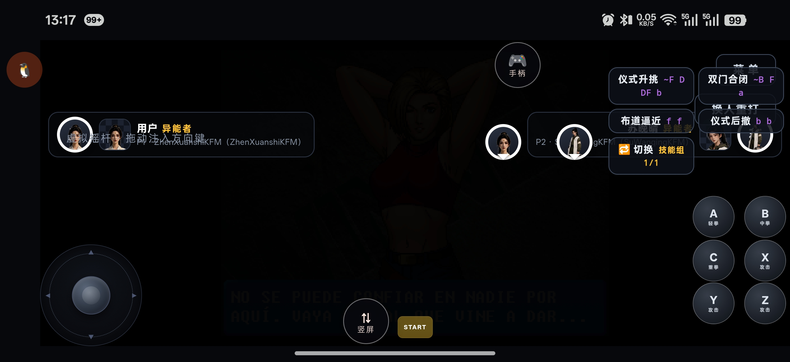

# 技能与黑屏
终端：安卓手机
## 技能问题
- 技能第一次释放

出现特效残留很久都没有消失
- 技能后续释放
再也没有技能特效，只有飘字

- 技能无“击中”效果
看见每个角色都是一个如“轻拳”的技能和碰撞判定和几个前冲后冲技能，没啥交互体现
参考 “toonflow-field-survival” 的圆形范围攻击和扇形范围攻击，远程近程攻击，
伤害和buff 等机制。

## 黑屏
- 进入战斗界面
加载-倒数，会出现一个非常缓慢的黑屏倒数效果，绝对不止3秒 

- 完了一局后 继续黑屏卡死

## 返回选人
点击返回选人，会跳到 角色资产绑定界面而不是选人界面。
选择一个故事也会进入到角色资产绑定界面，正确应该是选择了就回主界面。

# 问题与解决方案

> 2026-11-27 全部修复并部署真机（APK 四步流水线 + 资产集外科推送），PC / 真机探针全部回归通过。

## 技能问题

**① 特效残留很久不消失 + ② 后续释放只有飘字（缺陷B）** —— 同根因，两处叠加：

- 根因1：环形粒子算出负半径，`ctx.ellipse()` 抛 `IndexSizeError` 打断整帧绘制 → 粒子生命不再衰减（画布冻在最后一帧=「残留」），后续释放也不再出粒子（=「只有飘字」）。
- 根因2：特效循环用 rAF 驱动，窗口被遮挡 / WebView 节流时 rAF 停摆，特效冻结。
- 修复：单粒子绘制包 try/catch、半径钳正（一个粒子画崩不拖垮整帧）；循环改 `setInterval(16ms)` + `performance.now()` 墙钟 dt（低帧率也按钟表时长播完，页面切后台清屏、回前台续播）；加 700ms 看门狗，循环停摆超 1.5s 自动清屏重启。
- 回归：PC `probe-skfx-repeat` 10/10、真机 `probe-device-fx` 10/10。

**③ 无「击中」效果 / 范围 / 伤害 / buff（缺陷E）** —— 参考 toonflow-field-survival 机制，引擎画面是 wasm 画的盖不进去，全部走前端可视化层，信号靠 Lua 桥：

- 引擎侧新增 `external/script/combatfx.lua`：每 2 帧采样双方 `life()`，掉血即输出 `TF_HIT:受害者,伤害,坐标`（坐标口径与头顶头像一致）；兜底层与资产集各一份，两份 main.lua 都挂 require，两个 manifest 已重建（engine local74 / 资产集 local72）。
- 前端解析 TF_HIT → 受害者位置画**击中环 + 火花 + 伤害数字**（上飘渐隐、属性着色，截图已确认）。
- 技能释放按语义归类 → **圆形 / 扇形（半角30°）地面范围指示**（field-survival 的 RangeIndicator 手法：压扁椭圆 + alpha 随生命衰减）、突进冲刺速度线、远程**弹道飞行 + 到达爆点**。
- buff 类技能（蹲防/蓄势）→ 头顶绿色徽章（真实时间戳到期自动摘除，即 field-survival 的 buffUntilMs 口径）+ 护体环；资产侧以后也可给技能直接配 `range` 字段覆盖自动归类。
- 回归：PC `probe-combat-fx` 16/16、真机 `probe-device-combat-fx` 16/16（cone/melee/dash/buff/proj 五类归类 + TF_HIT 伤害 40/30 + 徽章 6s 自动摘除）。

## 黑屏

**① 进入战斗「黑屏倒数不止 3 秒」（缺陷C-1）**：

- 根因：加载期 wasm 长时间独占主线程，JS 的 setTimeout 回调整体被拖长（真机实测「3 秒倒数」跑了 6.5s）；且加载期挂着一个不动的数字，看起来就是黑屏倒数。
- 修复：倒数数字改 **CSS 动画**驱动（合成器线程，只动 opacity/transform，主线程被卡也按墙钟走完），总时长恒 ≈2.6s、数字间隔精确 650ms；引擎没就绪前不再播假倒数，显示「载入中…」呼吸提示，就绪后才跑 3-2-1-开打。
- 回归：真机 `probe-device-countdown` 4/4。

**② 打完一局后黑屏卡死（缺陷C-2）**：

- 根因：quickmatch 一场一进程，结算后旧逻辑回 `?conn=1&session=` 落到「角色资产绑定」视图，感知为卡死/跳错界面。
- 修复：结算回写后自动导航回 `?mode=<模式>` 选人屏（保留会话上下文，可直接开下一场）；引擎退出 / 上下文丢失 / 冻结 8s 有自愈链兜底 reload。
- 回归：真机 `probe-device-result` 4/4。

## 返回选人

**缺陷D**：

- 根因：openStory 的 preset 分支无条件 `showListView()`，把绑定视图覆盖回去；「选择一个故事」也走了同一条路。
- 修复：「切换故事 / 选择故事」→ 选完会话关面板回主界面；只有「角色实体绑定」入口才进绑定视图；打完一局带 `?mode=` 回来时不弹故事面板。
- 回归：真机 `probe-device-nav` 8/8。