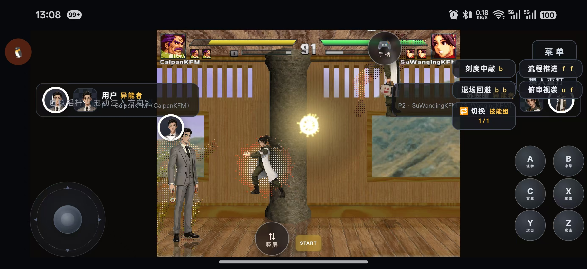
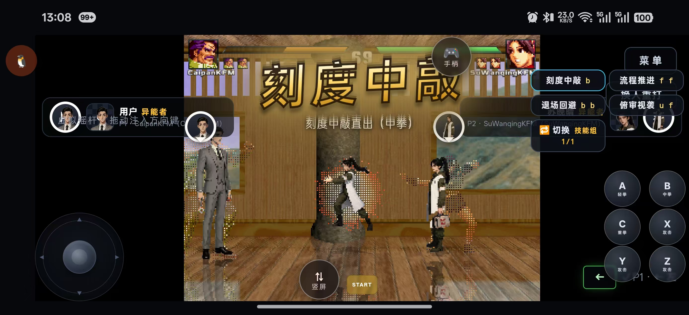

# 技能与黑屏
终端：安卓手机
## 技能问题
- 技能第一次释放

出现特效残留很久都没有消失
- 技能后续释放
再也没有技能特效，只有飘字

- 技能无“击中”效果
看见每个角色都是一个如“轻拳”的技能和碰撞判定和几个前冲后冲技能，没啥交互体现
参考 “toonflow-field-survival” 的圆形范围攻击和扇形范围攻击，远程近程攻击，
伤害和buff 等机制。

## 黑屏
- 进入战斗界面
加载-倒数，会出现一个非常缓慢的黑屏倒数效果，绝对不止3秒 

- 完了一局后 继续黑屏卡死

## 返回选人
点击返回选人，会跳到 角色资产绑定界面而不是选人界面。
选择一个故事也会进入到角色资产绑定界面，正确应该是选择了就回主界面。

# 问题与解决方案