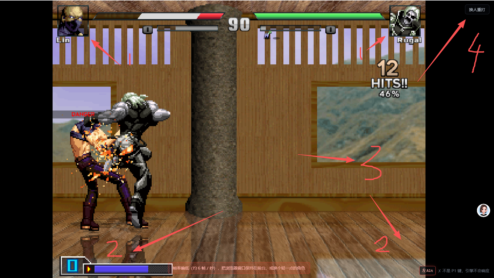
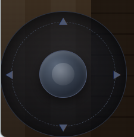
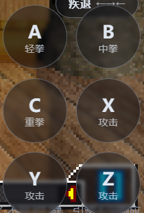
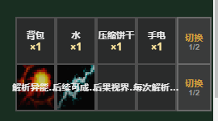
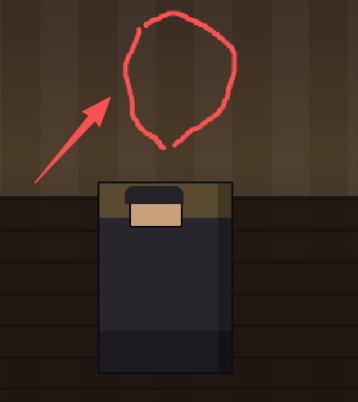

# 战斗界面

1. 同时显示 {toonflow-game角色头像} 和 {MUGEN 角色头像}
下面显示{toonflow-game角色名}{MUGEN 角色名} 职业等信息

注意：{toonflow-game角色头像} ，如果是webp 格式，那就是动图效果
2.显示虚拟手柄

3.显示快捷技能按钮

4.显示【菜单】按钮

5.悬浮头像

显示的是{toonflow-game角色头像} ，如果是webp 格式，那就是动图效果
# 流程
调用开场agent(agent 写在当前项目不要在后端，调用后端的大模型接口) 双方流式发言。接口出错超时等就跳过 。
系统设置里可以配置 战斗开场：文字发言/语音发言/3秒倒计时。

正式开打。

过程种可以随机触发发言。但是不影响战斗。

结束一场后触发 胜利发言agent。接口出错超时等就跳过 。

# 发言agent
要符合角色的人设和故事世界观。参考toonflow-game的角色发言和其输入的参数。