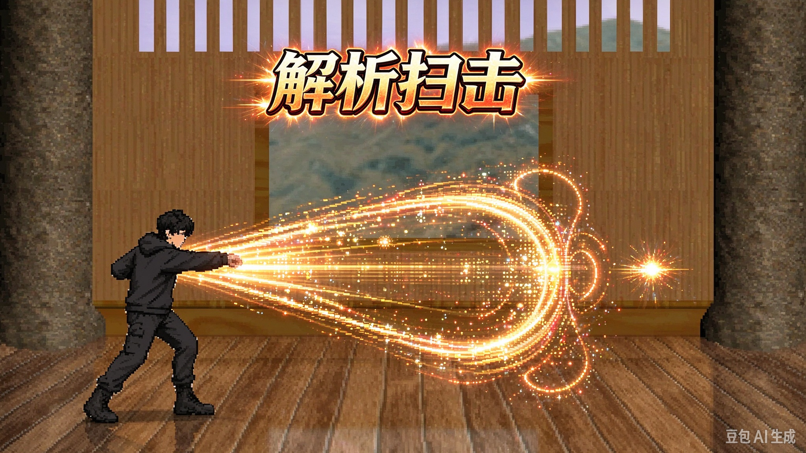
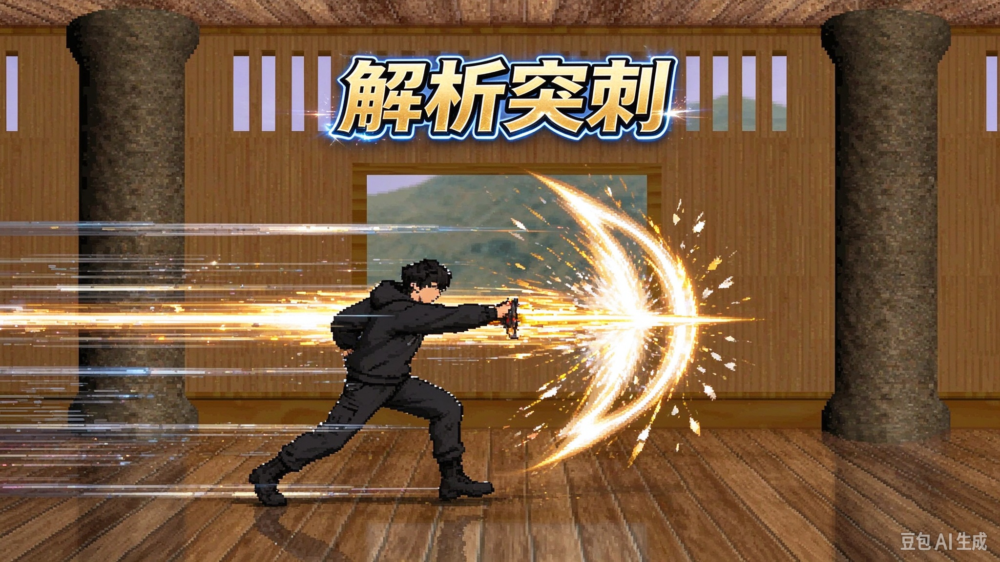
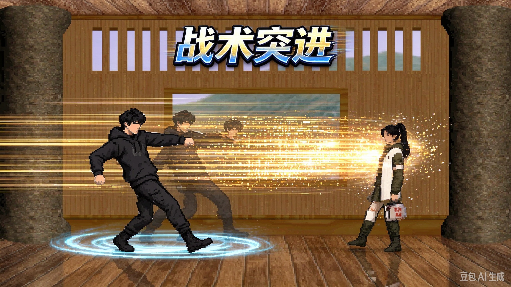
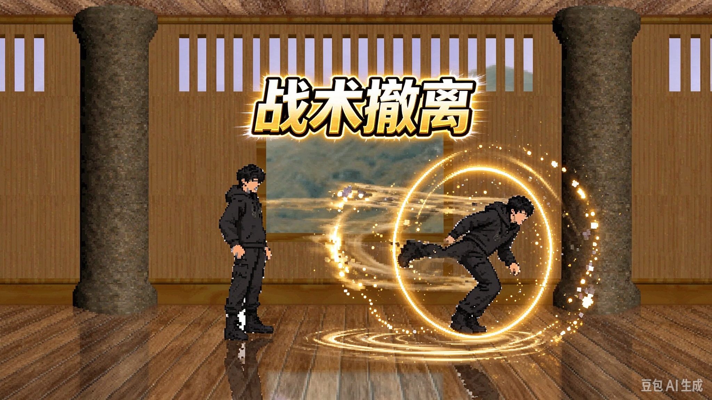
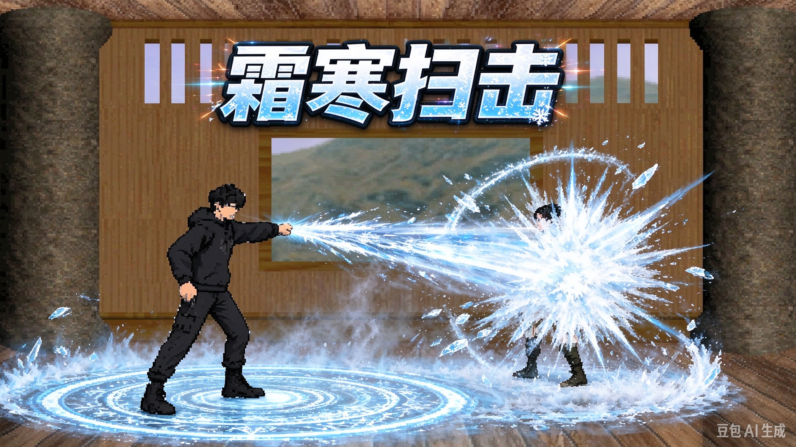
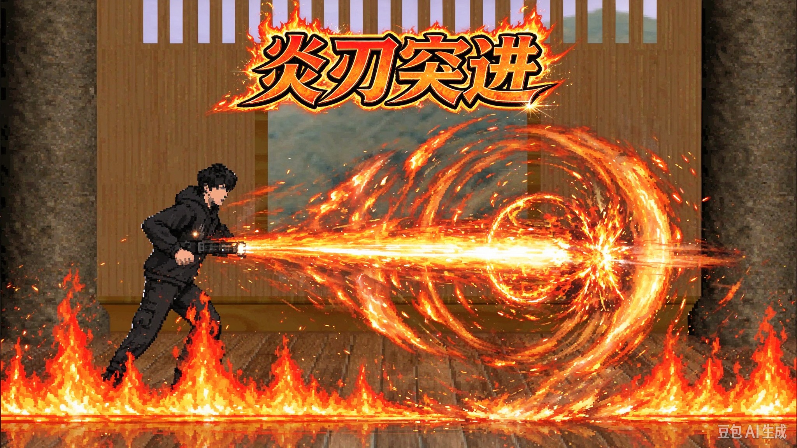
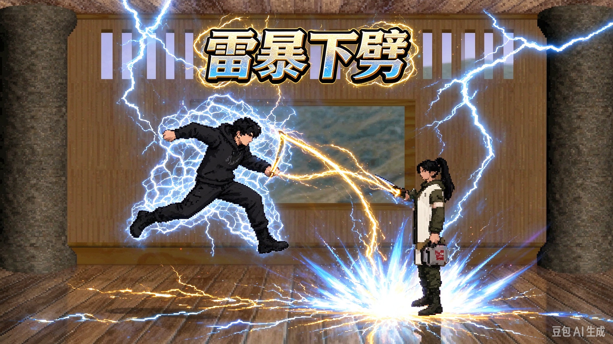
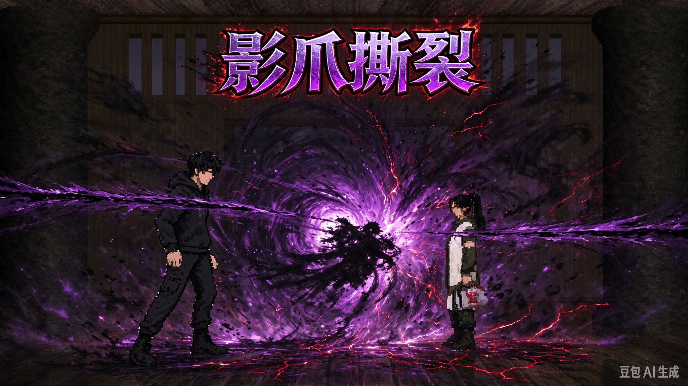

# 泛技能与属性特效（genericSkills）

> 来源：`../../../../workshops/toon-fighting-web/map_design_pre/末世选择，从解析神明开始成神/末世选择，从解析神明开始成神.md`
> 的角色异能档案 + `toonflow-field-survival` 的技能属性特效（effects_type）口径。
> 生成器：`../../../../.cache/scripts/gen-generic-skills-v2.mjs`（21 个角色 2026-11-27 已全量写入）。

每个角色 4 条泛技能，写在资产集 `chars/<id>/char.json` 的 `genericSkills` 字段，游戏端
（index.html 技能条 v2）读取后渲染成技能钮：按下 = **MUGEN 指令回放 + 属性色浮字 + 属性色爆发特效**。

## genericSkills 条目 schema

```jsonc
{
  "name": "回溯逆流",            // 主题技能名（按角色异能起名）
  "desc": "推出护体波反制（下·下后·后·扫击）",  // 一句话说明 + 拇指序提示
  "cmd": "~D DB B y",           // MUGEN [Command] token 序列（或移动指令 f f / b b / u f / d b）
  "fx": "water",                // ★属性特效（决定浮字颜色 + 爆发形态）
  "cd": 6,                      // 冷却秒（0=无冷却）
  "rarity": "rare"              // epic / rare / common（预留）
}
```

## 属性特效词汇（fx，对齐 field-survival effects_type）

| fx | 中文 | 主色（浮字/按钮键序） | 爆发形态（#skfx） |
|----|------|----------|------------------|
| `normal` | 凡 | 白 | 环爆 |
| `fire` | 火 | #ff6020 | 环爆+闪光+粒子 |
| `water` | 水 | #40b8ff | 环爆+闪光 |
| `thunder` | 雷 | #f8ff66 | 环爆+闪光+双倍粒子 |
| `wind` | 风 | #a0ffdd | 条纹粒子（拖尾） |
| `earth` | 土 | #c28c50 | 大慢尘环 |
| `metal` | 金 | #ffdd77 | 双斩波 |
| `wood` | 木 | #58dd66 | 环爆+闪光 |
| `light` | 光 | #fff9c2 | 环爆+闪光 |
| `dark` | 暗 | #b06ae0 | 聚拢环（内吸） |
| `poison` | 毒 | #88dd33 | 下坠液滴粒子 |
| `bleed` | 血 | #dd2233 | 下坠液滴粒子 |

效果图：
- 金色





- 冰

- 火

- 雷

- 暗


- 例子：
  - 末日故事-林羽
    解析扫击中 改成进程攻击 两米距离，特效改为胸前发出。范围到哪里特效到哪里。
    解析突刺 改为远程攻击   释放球体 出去 ，属性为  木属性。
    战术突进 整个人冲过去  三次连击判定。属性雷。
    战术撤离  整个人往后撤离  回血总量的1%，加攻击力5，持续5秒，属性暗。
    问题风暴  释放球体 出去 ，属性为  风属性。
    其他角色也改成五个技能以上，参数参考整个但是不要一样。

实际测试：
要求:解析突刺 改为远程攻击   释放球体 出去 ，属性为  木属性。 
实际测试：球体没有伤害判定。球体也不明显，然后这个球体 改为出场景边缘才清除，碰到的都扣血。
问题风暴：释放球体 出去 ，属性为  风属性。 距离为5米。（假设一个角色站立宽度是一米 那么就是距离角色5个站位的距离）
实际测试：球体没有伤害判定。

然后增加了 ikemen-fs/file/images/spells
和 workshops/toon-fighting-web/map_design/末世选择，从解析神明开始成神/images/spells
属性特效参考 D:\Users\viaco\tools\Toonflow-game\toonflow-game-plugins\plugins\toonflow-field-survival 如何使用这些 spells


游戏端支持（index.html，2026-11-27 晚按上面效果图重做）：
- **技能名艺术字** `.skillpop b`：56px 粗黑斜切体（rotate+skew），三段渐变填充（`background-clip:text`）
  + 2.5px 深色描边 + 属性色双重发光 + 弹入动画；每属性一套渐变（`--sk1/2/3` 主色 + 光晕 `--skg`）；
- **`#skfx` 全屏 Canvas 粒子引擎**（替代 DOM 粒子）：`lighter` 叠加发光；粒子 kind =
  spark(拖尾光点) / arc(弧线光带) / streak(速度线) / ring·ringE(圆环·地面透视椭圆) /
  bolt(闪电折线) / crystal(冰晶片) / flame(火苗) / mist(雾团) / shard(碎石) / drop(液滴) / glow(大光晕)；
  12 属性各配发射器（对标上方效果图）：
  - light/metal（金）：螺旋金光带 + 横向速度线 + 尽头星爆（图1/2）
  - water（冰）：脚下三层冰纹法阵 + 对面冰晶爆（白核+晶片放射）+ 雾（图4）
  - fire：脚下火焰 + 火旋涡弧带 + 火星（图5）
  - thunder：落雷×2 + 地面径向电弧 + 黄白火花（图6）
  - dark：紫黑漩涡内吸 + 中心亮核 + 红色电弧 + 暗雾（图7）
  - wind 风流线 / earth 尘环+碎石 / wood 落叶光环 / poison·bleed 液滴溅落 / normal 白环爆
- 锚点：P1 头顶悬浮头像（无坐标包时回落画布 30%/45%），地面点 = 锚点+84px，对面爆点 ≈ +210~260px；
- 粒子 life 按帧递减（dt 钳制 0.05s），低帧率设备上播放时长自动拉长（视觉帧数一致）；播放完自清；
- 未知 fx 回落 normal 白环爆；技能钮键序文字仍按属性主色（`--fxc`）；
- 验证探针：`.cache/scripts/probe-skfx-canvas.mjs`（10/10：艺术字 CSS 断言 + 各属性 canvas 像素非空 + 自清）。

## 主题命名（末世包 21 角色）

| 角色 | 属性 | 主题 | 技能名示例 |
|------|------|------|-----------|
| 林羽 / LinYuKF/KFA/KFM | light | 解析（金色数据流） | 解析突刺 / 规则重击 / 战术突进 |
| 苏晚晴 SuWanqingKFM | water | 回溯·急救 | 回溯逆流 / 急救重锤 / 病历横扫 / 手术刀突刺 |
| 林悦 LinYueKFM | light | 印记共鸣 | 印记回响 / 金纹突刺 / 预言迸发 |
| 老雷 LaoLeiKFM | earth | 铁壁·消防斧 | 铁壁反弹 / 消防斧重劈 / 战地咆哮 |
| 裁判 CaipanKFM | metal | 判罚·金刻度 | 刻度中敲 / 终审判罚 / 判罚笔突刺 |
| 赵大川 ZhaoDachuanKFM | normal | 凡人·司机 | 油门冲撞 / 急退避让 / 攀车跳击 |
| 陈阿姨 ChenAyiKFM | wood | 大锅饭 | 铁勺上撩 / 热汤泼击 / 大锅焖击 |
| 白术 BaishuKFM | wind | 顺风耳·黑市 | 风语冲击 / 黑市风暴 / 钻营突进 |
| 江浩 JiangHaoKFM | fire | 蛮力爆发 | 蛮力冲锋 / 跃起扣杀 / 扛击蹲防 |
| 甄选使 ZhenXuanshiKFM | dark | 锁定·逆选会 | 献祭之门 / 仪式升挑 / 布道逼近 |
| 小铃铛 XiaoLingdangKFM | thunder | 铃鸣·黑雾 | 铃音冲击 / 黑雾铃爆 / 谜语回声 |
| Hinako | earth | 相扑 | 大太鼓 / 横张手 / 四股踏波 |
| K' | fire | 焰 | 焰壁反弹 / 升焰拳 / 焰环爆 |
| Leona | thunder | 军雷 | 月牙雷波 / 雷光升刺 / 军雷爆发 |
| Lin | poison | 毒雾 | 雾隐突进 / 毒雾跳袭 / 雾中蹲防 |
| Rugal2nd | dark | 霸道 | 毁灭波动 / 灭世冲击 / 不屑后撤 |
| 98-kim | wind | 脚刀 | 疾风突进 / 飞燕跳袭 / 正气蹲防 |
| MasterRyu | normal | 格斗 | 突进 / 后撤 / 跳击 / 蹲防 |

## 指令来源口径（与 analyze-pad-buttons 一致）

- 有接线指令的角色：从 def→cmd 的 [Command] 里取**被 def 声明状态文件引用**的指令
  （双层过滤），按模板分类（波动/反射/升龙/双子/超必杀/蓄力），不足 4 条用单键补位。
- 零接线角色（江浩/赵大川/98-kim/Lin/MasterRyu 等纯 AI 打法包）：改配**引擎公共移动技**
  兜底——突进 `f f` / 疾退 `b b` / 跳袭 `u f` / 蹲防 `d b`（走 common 状态，按键必然有反应），
  不再出现「按了没反应」的废钮。

## 同步到手机

char.json 属于资产集（不进 APK）：改完跑生成器后，用
`adb push .cache/pack-sync-patch /data/local/tmp/… + run-as cp` 外科同步（注意先
`rm -rf` 旧暂存目录——adb push 到已存在目录会嵌套一层，cp 到旧内容等于没更新）。
